# Digital Image Processing (DIP) Final Project Report

**Project Title:** End-to-End Digital Image Processing Pipeline for Vision-Language Captioning, Spatial Saliency Analysis, and Explainable Heatmap Localization  
**Course:** Digital Image Processing (DIP)  
**Author:** Ashish Pathak  
**Repository:** [https://github.com/Ashish-P24/Image-Captioner](https://github.com/Ashish-P24/Image-Captioner)  

---

## 1. Executive Summary & Problem Formulation

### 1.1 Motivation & Context
Traditional image captioning systems implemented in academic settings predominantly rely on legacy architectures—namely, a pre-trained convolutional neural network (e.g., VGG-16 or InceptionV3) paired with a Long Short-Term Memory (LSTM) recurrent network trained on small, domain-restricted datasets such as Flickr8k. These older models suffer from two major flaws:
1. **Severe Semantic Hallucination:** Due to dataset bias and limited parameter capacity, they repeatedly predict generic, inaccurate phrases (e.g., predicting *"a dog running through the water"* on images containing businessmen in suits).
2. **Lack of Digital Image Processing (DIP) Rigor & Transparency:** They treat the image as a black-box vector, providing no visibility into spatial frequency components, edge characteristics, contrast distributions, or pixel-level spatial attention.

### 1.2 Project Objectives
This project develops an end-to-end, scientifically grounded **Digital Image Processing and Vision-Language Analysis System** that:
- Deploys a state-of-the-art multimodal vision-language model (**Salesforce BLIP** paired with **OpenAI CLIP**) to produce highly accurate, context-aware image descriptions.
- Implements and visualizes classical DIP algorithms in spatial and frequency domains: Luminance conversion, Global Histogram Equalization, CLAHE, Sobel gradient filtering, Canny edge detection, and Laplacian high-pass filtering.
- Quantifies objective image quality through statistical metrics: Laplacian variance sharpness, Shannon spatial entropy, RMS contrast, dynamic range, and colorfulness.
- Solves the visual explainability problem using multiple spatial localization methodologies: **Grad-CAM (Gradient-weighted Class Activation Mapping)**, **Fourier Spectral Residual Saliency**, and **Vision Transformer (ViT) Patch Attention Rollout**.
- Automatically extracts and draws high-salience **Region-of-Interest (ROI)** bounding boxes around the primary visual subjects.

---

## 2. System Architecture & Workflow

```mermaid
flowchart TD
    A["Raw Input Image (RGB)"] --> B["DIP Preprocessing & Statistics Engine"]
    A --> C["Deep Vision-Language Backbone"]
    A --> D["Spatial Saliency & Heatmap Engine"]

    subgraph DIP_Engine ["1. DIP Spatial & Frequency Transformations"]
        B --> B1["Luminance Decomposition: Y = 0.299R + 0.587G + 0.114B"]
        B --> B2["Contrast: Global Hist Eq vs CLAHE (Tile 8x8)"]
        B --> B3["Spatial Derivatives: Sobel Gx/Gy & Laplacian"]
        B --> B4["Canny Optimal Edge Map (NMS + Hysteresis)"]
        B --> B5["DIP Statistics: Sharpness, Entropy, RMS Contrast, Colorfulness"]
    end

    subgraph VL_Engine ["2. Vision-Language Generation & Alignment"]
        C --> C1["ViT Patch Embedding (16x16 Patches -> 576 Tokens)"]
        C --> C2["BLIP Multimodal Decoder: Autoregressive Beam Search"]
        C --> C3["Summary Caption & Detailed Aspect Description"]
        C --> C4["CLIP Cosine Similarity Alignment: S = (v_I · v_T) / (||v_I|| ||v_T||)"]
    end

    subgraph Saliency_Engine ["3. Explainability & Spatial Heatmaps"]
        D --> D1["Grad-CAM: α_k = (1/Z) Σ dY/dA_k on Conv Feature Maps"]
        D --> D2["Fourier Spectral Residual: IFFT(exp(R(f) + i·P(f)))"]
        D --> D3["Colormap Blending (JET / TURBO / INFERNO)"]
        D --> D4["Morphological ROI Bounding Box Segmentation"]
    end

    B5 --> E["Interactive Streamlit Cyberpunk Dashboard"]
    C3 --> E
    C4 --> E
    D3 --> E
    D4 --> E
```



---

## 3. In-Depth Technical Breakdown by Module

### 3.1 Module 1: Classical Digital Image Processing Transformations

The system explicitly subjects the input image to fundamental DIP spatial and frequency operations before semantic interpretation:

#### A. Grayscale Luminance Conversion
Converts an RGB image $I(x, y) \in \mathbb{R}^{H \times W \times 3}$ to a single-channel intensity map using the ITU-R BT.601 standard:
$$Y(x, y) = 0.299 \cdot R(x, y) + 0.587 \cdot G(x, y) + 0.114 \cdot B(x, y)$$
*Purpose:* Isolates achromatic luminance from chromatic channels, removing color bias for gradient and frequency analysis.

#### B. Global Histogram Equalization
Redistributes the discrete pixel intensity probabilities $p_r(r_k) = \frac{n_k}{MN}$ across the full dynamic range $[0, L-1]$ (where $L=256$) using the Cumulative Distribution Function (CDF):
$$s_k = T(r_k) = (L - 1) \sum_{j=0}^{k} p_r(r_j) = \frac{L - 1}{MN} \sum_{j=0}^{k} n_j$$
*Purpose:* Flattens the intensity histogram, maximizing global contrast across underexposed or overexposed regions.

#### C. Contrast Limited Adaptive Histogram Equalization (CLAHE)
Overcomes the noise amplification defect of global histogram equalization by partitioning the image into contextual grids ($8 \times 8$ non-overlapping tiles). The local histogram is clipped at a predetermined threshold (clip limit $\beta = 2.5$). The clipped excess is uniformly redistributed across all bins, followed by bilinear interpolation across tile boundaries to eliminate artificial block borders:
$$p_{\text{clipped}}(i) = \min(p(i), \beta)$$
*Purpose:* Enhances subtle local contrast and edge boundaries without amplifying background sensor noise.

#### D. First-Order Spatial Derivatives (Sobel Operator)
Applies separable $3 \times 3$ convolution kernels to compute horizontal and vertical spatial gradient approximations:
$$G_x = \begin{bmatrix} -1 & 0 & +1 \\ -2 & 0 & +2 \\ -1 & 0 & +1 \end{bmatrix} * I, \quad G_y = \begin{bmatrix} -1 & -2 & -1 \\ 0 & 0 & 0 \\ +1 & +2 & +1 \end{bmatrix} * I$$
The total gradient magnitude and direction are formulated as:
$$G(x, y) = \sqrt{G_x(x, y)^2 + G_y(x, y)^2}, \quad \theta(x, y) = \arctan\left(\frac{G_y(x, y)}{G_x(x, y)}\right)$$
*Purpose:* Detects rapid intensity changes corresponding to object contours and physical structural edges.

#### E. Canny Edge Detection
Implements John F. Canny’s optimal edge detection pipeline:
1. **Gaussian Smoothing:** Convolves image with a $5 \times 5$ Gaussian kernel ($\sigma = 1.4$) to suppress high-frequency noise.
2. **Gradient Computation:** Determines gradient vector magnitude $G$ and rounded orientation $\theta \in \{0^\circ, 45^\circ, 90^\circ, 135^\circ\}$.
3. **Non-Maximum Suppression (NMS):** Thinning edge ridges by preserving only local maxima along the gradient direction:
   $$M(x, y) = \begin{cases} G(x, y) & \text{if } G(x, y) \ge G(x \pm \Delta x, y \pm \Delta y) \\ 0 & \text{otherwise} \end{cases}$$
4. **Hysteresis Dual Thresholding:** Employs low ($T_{\text{low}} = 100$) and high ($T_{\text{high}} = 200$) thresholds. Pixels $> T_{\text{high}}$ are strong edges; pixels between $T_{\text{low}}$ and $T_{\text{high}}$ are retained only if connected to strong edges via 8-connectivity.

#### F. Second-Order Derivative (Laplacian Operator)
Computes the isotropic second spatial derivative:
$$\nabla^2 I = \frac{\partial^2 I}{\partial x^2} + \frac{\partial^2 I}{\partial y^2} \approx \begin{bmatrix} 0 & 1 & 0 \\ 1 & -4 & 1 \\ 0 & 1 & 0 \end{bmatrix} * I$$
*Purpose:* Detects edge zero-crossings and isolates fine structural detail and texture.

---

### 3.2 Module 2: Quantitative DIP Image Quality Metrics

The system calculates 5 objective statistical metrics to profile the input image:

| Metric | Mathematical Formulation | DIP Interpretation |
| :--- | :--- | :--- |
| **Spatial Sharpness** | $\sigma^2_{\nabla^2 I} = \frac{1}{MN}\sum_{x,y} (\nabla^2 I(x,y) - \mu_{\nabla^2})^2$ | Variance of Laplacian filter response. High values ($>100$) indicate crisp focus and fine details; low values ($<30$) indicate blur. |
| **Shannon Spatial Entropy** | $H = -\sum_{i=0}^{255} p(i) \log_2 p(i)$ | Information density in bits. Uniform/blank images approach $0$ bits; rich, textured images approach the theoretical maximum of $8.0$ bits. |
| **RMS Contrast** | $\sigma_{\text{RMS}} = \sqrt{\frac{1}{MN}\sum_{x=0}^{M-1}\sum_{y=0}^{N-1} (I(x,y) - \bar{I})^2}$ | Standard deviation of grayscale pixel intensities, measuring global dynamic contrast dispersion. |
| **Dynamic Range** | $\Delta I = \max(I(x,y)) - \min(I(x,y))$ | The span of intensity values utilized between absolute dark and bright pixels (range: $[0, 255]$). |
| **Hasler-Süsstrunk Colorfulness** | $C = \sqrt{\sigma_{rg}^2 + \sigma_{yb}^2} + 0.3\sqrt{\mu_{rg}^2 + \mu_{yb}^2}$ | Measures chromatic variance in opponent color spaces: $rg = R - G$ and $yb = 0.5(R + G) - B$. |

---

### 3.3 Module 3: Deep Vision-Language Architecture (BLIP & CLIP)

#### A. Vision Transformer (ViT-B/16) Encoder
- The 2D input image $I \in \mathbb{R}^{H \times W \times C}$ is reshaped into a sequence of flattened 2D patches $x_p \in \mathbb{R}^{N \times (P^2 \cdot C)}$, where $P = 16$ is the patch resolution and $N = \frac{HW}{P^2} = \frac{384 \times 384}{16 \times 16} = 576$ patches.
- Patches are linearly projected to dimension $D = 768$ and prepended with a learnable `[CLS]` token:
  $$z_0 = [x_{\text{class}}; x_p^1 E; x_p^2 E; \dots; x_p^N E] + E_{\text{pos}}, \quad E \in \mathbb{R}^{(P^2 C) \times D}, \; E_{\text{pos}} \in \mathbb{R}^{(N+1) \times D}$$
- Multi-Head Self-Attention (MSA) layers propagate spatial context across the entire patch sequence:
  $$\text{Attention}(Q, K, V) = \text{Softmax}\left(\frac{QK^T}{\sqrt{d_k}}\right)V$$

#### B. Multimodal Decoder & Beam Search
- Text is generated autoregressively by conditioning the decoder on visual patch embeddings via cross-attention.
- **Beam Search Decoding:** Instead of greedy selection ($k=1$), the decoder tracks the top $B = 3$ probability paths:
  $$\hat{Y} = \arg\max_{Y} \sum_{t=1}^{T} \log P(y_t \mid y_{<t}, I)$$
- **Dual-Level Output:** Generates a concise summary caption (unprompted) and a detailed multi-aspect visual description (prompted with *"a detailed photography of"*).

#### C. Multimodal Semantic Cosine Similarity (OpenAI CLIP)
To objectively validate whether the generated text truthfully represents the image, the image embedding $v_I \in \mathbb{R}^{512}$ and text embedding $v_T \in \mathbb{R}^{512}$ are mapped into a shared latent hypersphere:
$$S_{\text{CLIP}} = \cos(\theta) = \frac{v_I \cdot v_T}{\|v_I\|_2 \|v_T\|_2}$$
- $S \ge 0.32$: **Excellent Alignment** (High semantic accuracy)
- $0.25 \le S < 0.32$: **Strong Alignment**
- $0.18 \le S < 0.25$: **Moderate Alignment**
- $S < 0.18$: **Weak Alignment**

---

### 3.4 Module 4: Spatial Heatmaps, Grad-CAM, & Saliency Analysis

A central contribution of this project is solving the **spatial explainability problem**: *How do we prove where the model was looking when it generated the description?*

#### A. The ViT "Attention Sink" Failure Mode (Identified & Resolved)
In standard Vision Transformers, the `[CLS]` token in the deepest layers (layers 10–12) suffers from a known artifact documented by *Darcet et al. (ICLR 2024)*: **Attention Sinks / Register Tokens**. The model uses low-entropy, uniform background patches (e.g., ocean waves, sky) as storage bins for global residual context. Consequently, raw ViT self-attention displays false hotspots in the corners while the main foreground subject (e.g., the dog) appears dark.

#### B. The Solution: Convolutional Grad-CAM Saliency
To achieve faithful visual localization, the system incorporates **Grad-CAM (Gradient-weighted Class Activation Mapping)** using convolutional feature maps ($A^k \in \mathbb{R}^{U \times V}$):
1. Compute the gradient of the predicted semantic class score $Y^c$ with respect to feature map activations $A^k$:
   $$\alpha_k^c = \frac{1}{Z} \sum_{i=1}^{U} \sum_{j=1}^{V} \frac{\partial Y^c}{\partial A_{i,j}^k}$$
2. Take the positive weighted linear combination through a Rectified Linear Unit (ReLU) to isolate features with a positive influence:
   $$L_{\text{Grad-CAM}}^c(x, y) = \text{ReLU}\left(\sum_{k} \alpha_k^c A^k(x, y)\right)$$
3. **Result:** On the running dog image, the peak activation (**`1.00`**) is centered directly on the dog's body, head, and limbs, while the water and sky are suppressed.

#### C. Classical Frequency-Domain Saliency (Fourier Spectral Residual)
As an alternative classical DIP method, the system implements Hou & Zhang's Fourier Spectral Residual:
1. Compute 2D Fast Fourier Transform: $F(u, v) = \mathcal{F}\{I(x, y)\} = A(u, v) e^{j \Phi(u, v)}$.
2. Calculate log amplitude: $\mathcal{L}(u, v) = \ln(A(u, v))$.
3. Compute the spectral residual by subtracting the smoothed log spectrum $h_n(u, v) * \mathcal{L}(u, v)$:
   $$\mathcal{R}(u, v) = \mathcal{L}(u, v) - [h_n(u, v) * \mathcal{L}(u, v)]$$
4. Invert via Inverse Fast Fourier Transform (IFFT) to reconstruct spatial saliency:
   $$S(x, y) = g(x, y) * \|\mathcal{F}^{-1}\{\exp(\mathcal{R}(u, v) + j\Phi(u, v))\}\|^2$$

#### D. Region of Interest (ROI) Bounding Box Extraction
The continuous normalized heatmap $H(x, y) \in [0, 1]$ is converted to a discrete binary spatial mask using an adjustable threshold $\tau \in [0.3, 0.85]$:
$$M(x, y) = \begin{cases} 1 & \text{if } H(x, y) \ge \tau \\ 0 & \text{otherwise} \end{cases}$$
Morphological closing ($\mathcal{M} = (M \bullet K)$ with a $21 \times 21$ rectangular structuring element $K$) merges fragmented attention clusters, followed by contour extraction:
$$[(x, y, w, h)] = \text{BoundingRect}(\text{Contour}_i)$$
Glowing bounding boxes are overlaid on the original image to outline the detected primary semantic subjects.

---

## 4. Software Implementation & File Structure

The project is structured into modular Python files adhering to clean separation of concerns:

```
c:\Users\ashis\Desktop\DIP Final Project\
│
├── main.py               # Streamlit interactive web dashboard & layout engine
├── dip_pipeline.py       # DIP algorithms (filters, statistics, Grad-CAM, ROI)
├── model_inference.py    # Deep vision-language inference (BLIP & CLIP models)
├── evaluate_metrics.py   # Text evaluation metrics (BLEU-1..4, ROUGE-L, LCS)
├── requirements.txt      # Python dependencies specification
├── uploaded_image.jpg    # Sample benchmark test image
├── PROJECT_REPORT.md     # In-depth academic project documentation
└── README.md             # Project documentation & GitHub instructions
```

---

## 5. Experimental Results & Verification

### Test Benchmark 1: `uploaded_image.jpg` (Three Men in Suits)
- **Generated Summary Caption:** *"A group of three men standing next to each other"*
- **Detailed Description:** *"A detailed photography of three young men in suits"*
- **CLIP Semantic Cosine Score:** `0.2605` (**Strong Alignment**, 72.1% Confidence)
- **DIP Quantitative Metrics:**
  - Sharpness (Laplacian Var): `37.51`
  - Shannon Entropy: `7.739 bits` (High information density)
  - RMS Contrast: `59.86`
  - Dynamic Range: `255` (Full dynamic range utilized)
  - Colorfulness: `32.69`
- **Spatial Heatmap Result:** Grad-CAM placed high-intensity hotspots over the faces and torsos of all three individuals, with multi-object bounding boxes enclosing the group.

### Test Benchmark 2: Beach Dog Image
- **Generated Caption:** *"A dog running through the water with a camera"*
- **Grad-CAM Localization:** Center activation `0.68 - 1.00` centered squarely on the running dog.
- **ROI Segmentation:** Single high-confidence bounding box drawn around the dog's body, eliminating false background wave triggers.

---

## 6. Conclusion
This project demonstrates that integrating classical **Digital Image Processing (DIP)** spatial/frequency techniques with modern **Vision-Language Transformers** produces an explainable, robust, and accurate computer vision system. By diagnosing and fixing the ViT "Attention Sink" artifact with **Grad-CAM** and **Fourier Spectral Residuals**, the system bridges the gap between deep generative AI and foundational image processing science.
